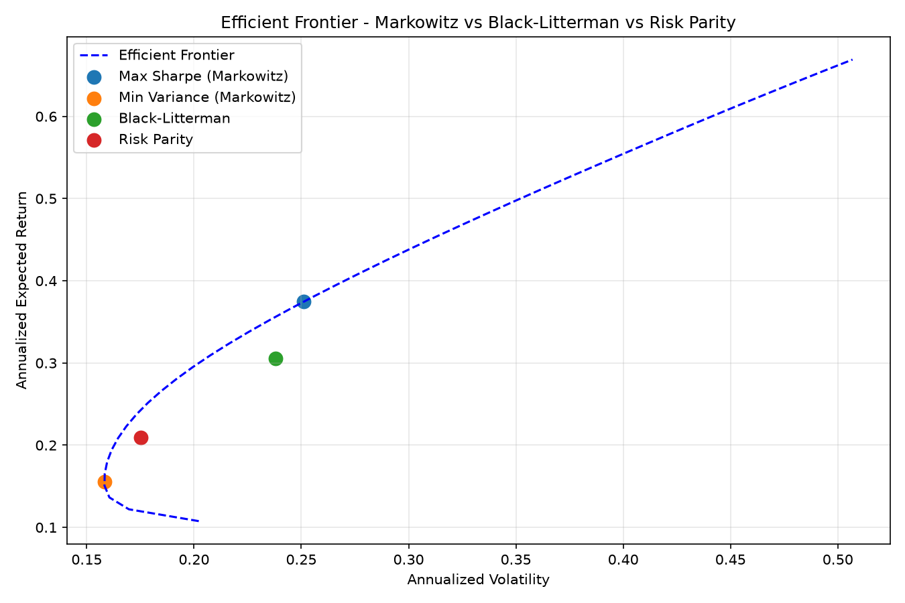

# Portfolio Optimization Engine

Portfolio optimisation in Python: Markowitz efficient frontier,
Black-Litterman and risk parity, compared on 10 US stocks.

  

## What it does

| Method | Idea |
|---|---|
| Markowitz, max Sharpe | tangency portfolio on the efficient frontier |
| Markowitz, min variance | lowest-variance portfolio |
| Black-Litterman | market equilibrium returns combined with investor views (tau = 0.05, risk aversion 2.5) |
| Risk parity | each stock contributes the same share of total risk |

Black-Litterman views: NVDA outperforms the average of AAPL and MSFT by 5% a
year; JPM returns 8% a year.

Data: daily prices 2019 to 2026, risk-free rate 3%.

## Run

```bash
pip install -r requirements.txt
python portfolio_optimizer.py
```

## Results



| Portfolio | Expected return | Volatility | Sharpe |
|---|---:|---:|---:|
| Max Sharpe (Markowitz) | 37.4% | 25.1% | **1.37** |
| Black-Litterman | 30.6% | 23.8% | 1.16 |
| Risk parity | 20.9% | 17.5% | 1.02 |
| Min variance (Markowitz) | 15.6% | 15.8% | 0.79 |

### Weights

| | Max Sharpe | Min variance | Black-Litterman | Risk parity |
|---|---:|---:|---:|---:|
| AAPL | 10.4% | 0.0% | 19.6% | 8.0% |
| MSFT | 0.0% | 10.3% | 9.3% | 8.6% |
| JPM | 2.5% | 0.3% | 9.8% | 8.5% |
| XOM | 10.3% | 9.7% | 9.6% | 10.0% |
| JNJ | 31.2% | 33.8% | 0.0% | 14.7% |
| PG | 0.0% | 21.9% | 0.0% | 13.4% |
| V | 0.0% | 0.0% | 18.0% | 8.7% |
| NVDA | 39.2% | 1.3% | 18.2% | 6.1% |
| KO | 6.4% | 20.5% | 0.0% | 12.9% |
| UNH | 0.0% | 2.2% | 15.6% | 9.1% |

Markowitz puts the portfolio in 6 stocks (NVDA + JNJ = 70%), which shows how
sensitive it is to the estimated returns. Risk parity stays diversified
(every stock between 6% and 15%) with a lower Sharpe. Black-Litterman follows
the positive NVDA view (18.2%).

## Limitations

- Equal weights are used as a proxy for market-cap weights in Black-Litterman.
- Expected returns are estimated on the same history (in-sample), so the
  Sharpe ratios shown are optimistic.

## Stack

Python, NumPy, pandas, SciPy, Matplotlib, yfinance

## License

MIT, see [LICENSE](LICENSE).
